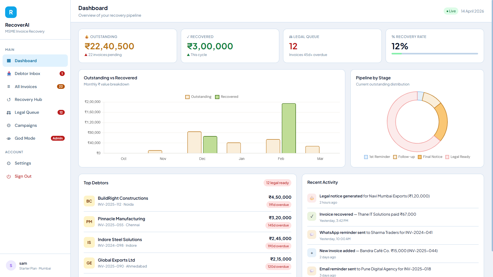
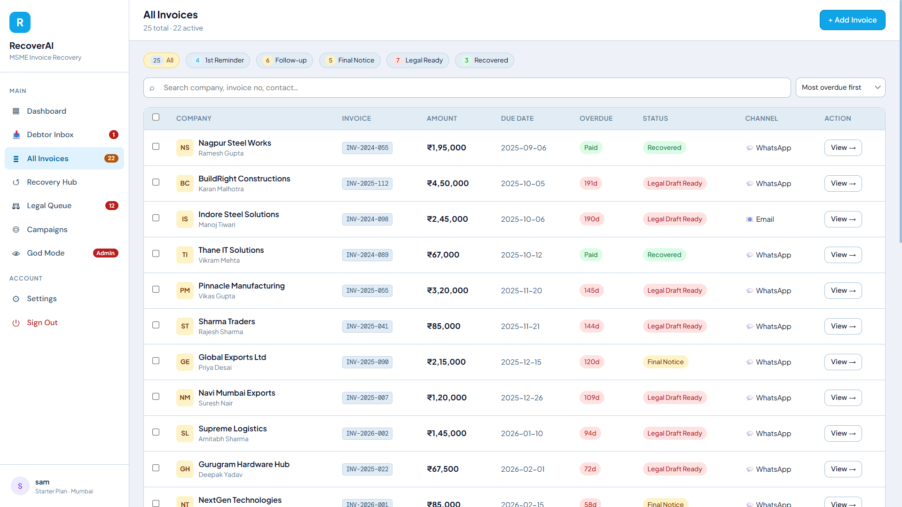
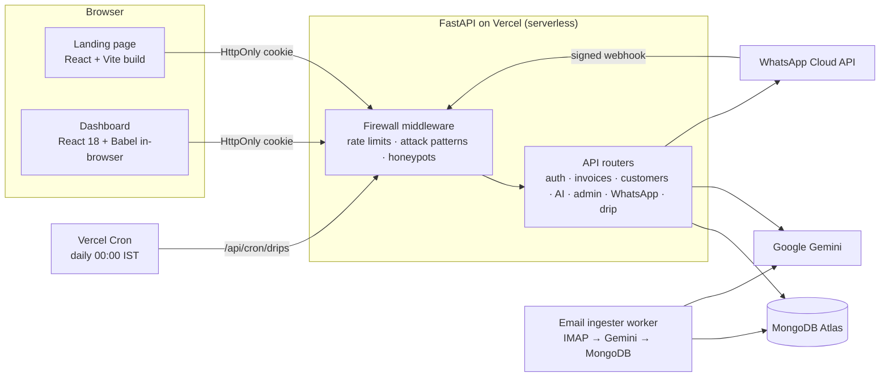

<div align="center">

# 🤖 RecoverAI

**AI-assisted invoice recovery for Indian MSMEs**

[](https://github.com/Sameerkc3579/RecoverAI/actions/workflows/ci.yml)
[](https://recover-ai-lyart.vercel.app)


RecoverAI helps small businesses get paid. It tracks overdue invoices, drafts recovery messages and escalating reminders with Google Gemini, classifies debtor replies in Hindi, Hinglish and English, computes statutory interest under the MSMED Act, and generates legal notices — so the owner reviews and sends instead of chasing.

**[Live demo →](https://recover-ai-lyart.vercel.app)**



</div>

---

## ✨ Features

- **AI recovery messages** — Gemini drafts reminders in four tones (Friendly → Firm Warning → Final Notice → Legal Threat), singly or in bulk, with automatic model fallback when a model is overloaded.
- **Debtor reply understanding** — replies are translated and classified as *promise to pay*, *dispute* or *stall* (Hindi/Hinglish/English), with a keyword fallback when the AI is unavailable. Evaluated on a labelled test set in [`eval/`](eval/).
- **Automated drip campaigns** — reminders are drafted at 7, 21, 35 and 45 days overdue, held for approval, never duplicated across workers, and caught up if a scheduled run is missed.
- **MSMED Act compliance** — compound interest with monthly rests at three times the RBI bank rate (Section 15), shown per invoice and in the legal queue.
- **One-click legal notices** — formal notices citing Sections 15–18, exported as PDF with amounts in Indian numbering and words.
- **Zero-touch email ingestion** — a worker reads invoice PDFs from an inbox, extracts the fields with Gemini, verifies the sender (SPF/DKIM/DMARC) and files the invoice under the right account.
- **WhatsApp Business** — Meta Cloud API webhook for inbound replies (HMAC-verified) and outbound messages to known debtors.
- **Debtor portal** — magic-link page where a debtor can see their invoice and accrued interest without an account.
- **Multi-tenant with an admin console** — every query is scoped to the owner; admins get platform-wide stats, user management and CSV export.
- **Google Sign-In** alongside email/password accounts.

<p align="center">
  
</p>

---

## 🏗️ Architecture



| Layer | Stack |
|---|---|
| Backend | FastAPI, Motor (async MongoDB), Pydantic v2, PyJWT, passlib/bcrypt, APScheduler |
| AI | `google-genai` — `gemini-2.5-flash` with tiered fallback; `gemini-3.5-flash-lite` for reply classification |
| Frontend | React 18 (no build step, compiled in the browser), Chart.js, html2pdf.js; landing page built with Vite |
| Data | MongoDB Atlas — TTL indexes for revoked tokens and login counters, unique indexes for idempotency |
| Hosting | Vercel (serverless Python) with Vercel Cron |

---

## 🔒 Security

- **Sessions in HttpOnly cookies** — short-lived access tokens (15 min) plus refresh tokens; JavaScript never sees a token.
- **Logout and brute-force protection that hold across instances** — revoked tokens and failed-login counters are stored in MongoDB, so every serverless instance enforces them (5 failures → 15-minute lockout, no user enumeration); per-instance memory is only a fallback if the database is unreachable.
- **Firewall middleware** — per-tier rate limits (auth / webhook / general), SQLi/XSS/path-traversal pattern blocking and honeypot paths that ban scanners.
- **Uploads** — extension and MIME allowlists, magic-byte content checks, size limit, random filenames.
- **SSRF protection** for website enrichment, **NoSQL-injection** sanitising of update payloads, **signed webhooks** (WhatsApp HMAC), **sender authentication** for ingested email.
- Full audit trail of findings and fixes: [`docs/bug-report.md`](docs/bug-report.md).

---

## 🚀 Getting started

**Prerequisites:** Python 3.10+, a MongoDB database (Atlas works), a [Gemini API key](https://aistudio.google.com/app/apikey).

```bash
git clone https://github.com/Sameerkc3579/RecoverAI.git
cd RecoverAI
python -m venv .venv
source .venv/bin/activate          # Windows: .venv\Scripts\activate
pip install -r requirements.txt

cp .env.example .env               # then fill in GEMINI_API_KEY, MONGO_URI, SECRET_KEY
uvicorn app.main:app --reload --port 8000
```

Open <http://localhost:8000>. Every setting is documented in [`.env.example`](.env.example); for local HTTP keep `COOKIE_SECURE=false`.

**Admin console:** add your email to `ADMIN_EMAILS` — the dashboard unlocks the admin view for those accounts.

### Optional tools

| Command | What it does |
|---|---|
| `python scripts/seed.py` | Loads realistic sample invoices |
| `python -m app.workers.email_ingester` | Runs one email-ingestion cycle (`--dry-run` reads the inbox without marking or saving anything) |
| `scripts/windows/setup_scheduled_task.ps1` | Registers the ingester as a 15-minute Windows scheduled task (run as Administrator) |
| `python scripts/simulate_whatsapp.py` | Sends a fake inbound WhatsApp message to a local server |
| `python scripts/start_ngrok_tunnel.py` | Exposes the local server for Meta webhook testing |
| `python -m eval.run_intent_eval` | Scores the reply classifier on the labelled test set |

---

## 🧪 Testing & CI

[GitHub Actions](.github/workflows/ci.yml) runs on every pull request and on every push to `main`:

- **Backend** — 79 pytest tests on Python 3.10 and 3.12 against a real MongoDB 7 service container: auth and session revocation, brute-force lockouts shared across instances, firewall rate limiting, tenant isolation, upload validation, the drip engine and its cron endpoint, admin, WhatsApp and the email ingester. Gemini is mocked, so CI needs no API keys.
- **Frontend** — every dashboard component is compiled with the exact Babel version the browser loads.

Run the suite locally (needs a MongoDB you can write a throwaway database to; tests refuse any database name without `test` in it):

```bash
pip install -r requirements-dev.txt
TEST_MONGO_URI=mongodb://localhost:27017 pytest
```

---

## ☁️ Deployment (Vercel)

1. Import the repository in Vercel — [`vercel.json`](vercel.json) routes all traffic to `app/main.py` and schedules the daily drip run (`/api/cron/drips`, 00:00 IST).
2. Add the environment variables from [`.env.example`](.env.example) (`COOKIE_SECURE=true` in production). Set `CRON_SECRET` (any long random string) — Vercel sends it with every cron call, and the drip endpoint refuses all calls without it. Keep `CRON_TIME_BUDGET_SECONDS` below the function's max duration.
3. For inbound WhatsApp, set `WHATSAPP_WEBHOOK_SECRET` (your Meta App Secret) and point the Meta webhook at `/api/webhooks/whatsapp`.

---

## 📁 Project structure

```
app/
  api/            route handlers (auth, invoices, customers, chat, admin, whatsapp, drip, enrich)
  core/           settings, database, security (tokens, limiter), firewall and middleware
  services/       Gemini messaging, reply NLP, MSMED interest, customers, WhatsApp
  workers/        drip scheduler, email ingester, WhatsApp reply drafting
static/           dashboard React components and CSS
dist/             pre-built landing page (Vite)
tests/            pytest suite
eval/             intent-classification evaluation
scripts/          seed data, simulators, Windows scheduler scripts, frontend compile check
docs/             bug report / security audit and project summary
```

---

<div align="center">
  <b>Built by Sameer Choudhary</b><br/>
  Helping Micro, Small and Medium Enterprises get paid on time.
</div>
